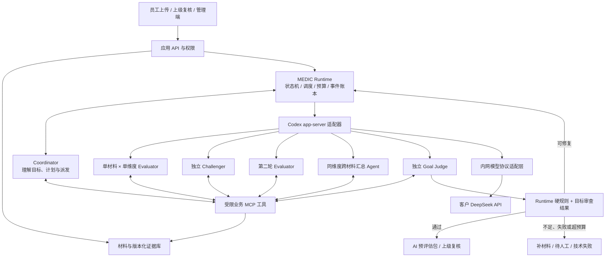
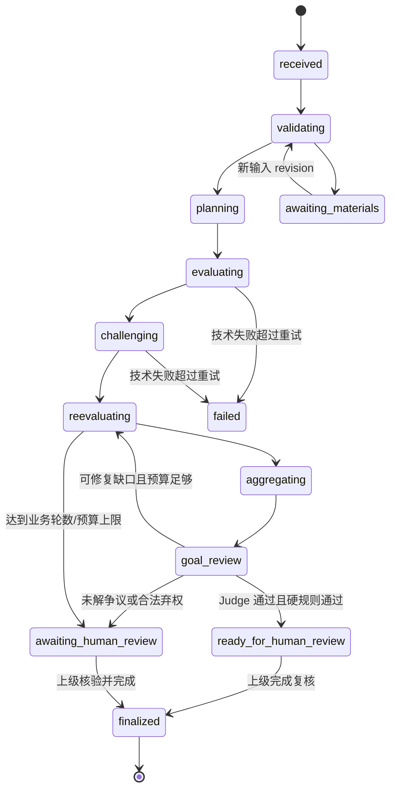

# MEDIC 员工胜任力评估 Agent 平台开发计划

版本：0.4 · 更新日期：2026-10-23 · 状态：P0、P1 已通过；P2–P5 待继续完成

## 当前交付快照（2026-10-23，提交前更新）

| 阶段 | 当前进度与验收边界 | 下一步 |
| --- | --- | --- |
| P0 / P1 | 基线、协议可行性及合成六角色闭环已通过，记录见 P0_REPORT.md / P1_REPORT.md | 保留固定源码和执行身份 |
| P2 | 持久任务、租约恢复、预算、跨材料汇总、争议/第三轮契约及部分真实探针已实现 | 补齐全真实消息往返与第三轮案例、持续完整服务负载；整阶段未通过 |
| P3 | 当前试用服务 v16，前端沿用 v14；按 UI-v1.02 实现三端导航、材料预览、人工复核、结果图表和推荐值浏览 | 正式 SSO、组织同步、推荐值发布和业务签收待完成；申诉及关联重评按用户要求暂缓 |
| P4 | A/B 执行器和对照管理已实现；v16 全范围 C 运行仍因引用校验失败，未产出完整报告 | 先验证引用提交候选，再进行新的前瞻完整评估；专家标注集和质量门槛签收尚未准备好 |
| P5 | 本地 SQLite/PostgreSQL 应用备份恢复，以及终态 SQLite 协议归档恢复已验证 | 生产部署、SSO 接口资料尚未准备好；生产恢复目标、隔离和上线验收待完成 |

本次重新获取 UI-v1.02 与归档 hash 一致；本地服务健康，8 个实际返回的前端文件与发布清单一致。浏览器预览超时，本次没有新增视觉验收，既有视觉验证的范围见 [P3 进展](P3_PROGRESS.md)。

**未发布候选 v17：** 已在隔离目录实现显式“按证据 ID 选择整段原文”的新提交工具，并以 v7 角色包启用。旧引用提交继续严格校验；范围、必读、上下文、档位规则、租约和原有修复额度保持。9 项本地 Store/ToolService 契约检查通过，无跳过；首次运行暴露一处测试读取了仅含已完成结果的快照，改为核对持久化提交后通过。尚未进行 PostgreSQL、真实模型或完整范围验证，不能宣称已解决真实模型失败，也未切换网页默认 v5 角色包。候选源码以[独立补丁](evals/candidates/evidence-selection-v17.patch)保存，说明见[候选记录](evals/candidates/README.md)，不混入当前运行的 v16 源码。

当前提交范围为 `medic/` 业务实现、测试、合成 fixture、公开验证摘要和计划文档。客户原始材料、凭据、数据库、模型原始协议及本地工具锁文件留在本地；不将这些私有资料随源码推送。P2–P5 仍未验收完成。

提交前另运行当前 v16 的构建身份、SQLite 应用 API、备份和终态归档相关检查，**55 项通过、无跳过**；该批不是全量回归或 PostgreSQL 验收。`medic/.gitattributes` 禁止自动换行转换，以使 Git 保存及检出的执行文件字节与既有冻结清单一致；未改写当前运行源码。

## 各版本进展与验证记录

当前运行发布为 v16，前端功能沿用 v14。v15 的完整 C 评估因模型抄错回执而失败；v16 的受控真实模型回执恢复探针通过，11 请求、98,539 tokens。62 项 SQLite 回归、13 项真实 PostgreSQL 检查及发布后 27 项 API/构建检查通过，试用库 25 张表不变。随后完整 17 项/2 材料/225 下游节点运行完成 15 个角色尝试后，因三次引用并非连续原文而失败；93 次预留、已报告小计 756,420 tokens，实际总量因两次未知用量保持空值。严格原文校验和修复额度不变，未发布报告或自动重跑。新增终态协议归档/恢复工具，28 项相关测试及本例 18 个 worker 的恢复核验通过，不替代生产备份验收。紧凑规划仍为 v6 显式实验功能，网页默认仍为 v5。完整 C 及 P4/P5 验收未通过，详见 [P4 最新进展](P4_PROGRESS.md)。

P2 当前进展见 [P2_PROGRESS.md](P2_PROGRESS.md)：跨重启预算、原子 outbox/租约领取、真实多材料汇总闭环与数据库中断恢复已通过；v5 的 mailbox 与第三轮返工已通过契约测试和真实续接探针，后者明确保留初始 fixture 边界。v7 已补齐两例初始六角色全真实的争议与逐项回应，证据不足时即使 Judge pass 也保留人工处理。应用版本冻结已实现。全真实角色的消息往返与第三轮完整案例、持续负载及部署相关验证仍待完成，P2 不标记通过。

P3 已增加 PDF/Office 解析、不可变快照、本地授权 API 与员工/上级/总监网页入口，支持原文定位、人工复核和独立定稿。虚构文件经真实 HTTP 到六角色评估的链路已验证，本地持续队列服务已实现；生产调度部署、OCR 质量签收与更广覆盖、生产 SSO 与业务签收仍待完成。详细范围见 [P3_PROGRESS.md](P3_PROGRESS.md)，不将参考材料读取成功或页面 fixture 测试等同于业务评分质量通过。

最新 v7 修复网关终态早于结算导致的并发误拒绝，以及 SQLite 只读轮询争抢写锁的问题，252 项回归通过（含 83 项真实 PostgreSQL）。新建的合成真实模型探针完整通过 HTTP 上传、自动六角色、独立门禁和合成人工定稿，30 次请求均结算；v6 失败记录保留，其原服务数据库异常缺少细码，不能追溯认定原因。下一步继续补齐争议全链、持续负载和部署验证。

P5 工程准备增加了本地 SQLite 与 PostgreSQL 应用、材料快照和原件的备份恢复工具，并完成独立恢复及 HTTP 核验，见[部署与恢复验证](deploy/README.md)。SQLite 演练沿用既有真实模型合成案例；PostgreSQL 演练使用明确的合成报告 fixture。完整协议归档、生产恢复目标、SSO 与客户上线验收仍未通过。

P0 执行结果见 [P0_REPORT.md](P0_REPORT.md)：固定源码已构建；资产基线已核验；真实 DeepSeek 经 Responses namespace 适配层完成 MCP、结构化输出、跨进程恢复、4 thread 并发及中断。下文保留总体设计与后续阶段要求，历史资产说明不替代该验收记录。模型/policy 仍为待业务签收候选，生产权限隔离尚未验收。

v9 已补齐冻结标准面板、五维/17 项覆盖与明细交互。完整回归 278 项通过（含 84 项真实 PostgreSQL）；最后仅调整面板 CSS，最终构建另通过 31 项受影响测试和桌面/手机浏览器核验。v8 的跨进程上传控制与真实双 API HTTP 核验继续保留。UI 全部功能、质量签收与生产部署仍未完成；见 [P3_PROGRESS.md](P3_PROGRESS.md)。

v10 增加 PDF 原页预览、翻页/放大与冻结证据红框，旋转和裁剪页面通过像素定位测试。完整回归 290 项全部通过，含 87 项真实 PostgreSQL；桌面及手机浏览器核验通过。Office 原件页图、OCR、图表理解和其它未完成项仍继续推进，不将 PDF 预览等同于全部格式完成。

2026-10-23 用户指定 [UI-v1.02 demo](https://img.medsci.cn/tob/moke/UI-v1.02.html) 为最新界面与交互参考。以其三类角色导航、蓝色视觉、主页、上传、复核、结果及推荐值页面对齐；保持后端授权与真实任务状态。demo 的 41 岗位旧数据、固定模拟评分、浏览器权威状态不作为生产逻辑。申诉仍暂缓。对齐完成度与差异见 [P3_PROGRESS.md](P3_PROGRESS.md)。

v11 已补齐五维/17 项图表全屏、缩放和明细查看，以及团队组合筛选、排序、分页和手机员工卡片。44 项受影响回归通过（含 18 项真实 PostgreSQL），19 项浏览器检查通过；本次未重跑完整套件。Office 原件预览、OCR、组织数据、配置发布及生产登录仍待完成，不标记全部 UI 对齐。

v12 接入固定引擎的 DOCX/PPTX/XLSX 转换页、跨页唯一文本定位及派生缓存，保留原件与原始评分证据。完整候选构建 302 项回归全部通过（含 89 项真实 PostgreSQL）；随后仅修复前端同一材料的重复点击，最终构建另通过 48 项受影响回归（含 20 项 PostgreSQL）及网页核验。Office 特殊域/公式与更广格式、OCR、组织资料、配置发布和生产登录仍待完成，详见 [P3 进展](P3_PROGRESS.md)。

v13 增加本地中英文纯扫描 PDF 辅助识别（每份最多 5 页），识别文字保留待人工核对状态，不能自动评分；原件、历史解析与评估不改写。完整候选 311 项通过（含 90 项真实 PostgreSQL），最终页面标签调整后另通过 50 项受影响回归（含 21 项 PostgreSQL）及桌面/手机核验。混合页、Office 内嵌图片、图表理解、质量签收、组织同步、配置发布和 SSO 仍待完成；申诉暂缓。详见 [P3 进展](P3_PROGRESS.md)。

v13 新增第三个前瞻合成真实案例，六角色和 16 项执行完整性检查通过，36 次请求、380,827 tokens，实际未产生争议、消息或第三轮；因此争议覆盖仍为 partial，不能与初始 fixture 探针拼成完整验收。核验器/用例生成器 12 项检查通过，详细边界见 [P2 进展](P2_PROGRESS.md)。

v13 已补充 SQLite 与真实 PostgreSQL 各 300 秒的独立事务负载：每种 150 个合成任务、450 次租约，4 个竞争进程和 1 个观察进程；各强制终止一个持有未结算预算的进程，替代进程恢复，23 项检查分别通过，独立只读 SQL 复核一致。核验器 13 项测试通过。此场景没有模型调用或评分结果，仅覆盖租约、outbox、预算和进程故障，不替代完整服务/协议负载或生产压测；P2/P5 仍未通过。见 [P2 进展](P2_PROGRESS.md#2026-10-23持续事务竞争与自然租约恢复)。

v14 按 UI-v1.02 补齐岗位推荐值的分类联动、岗位职级信息和 17 项能力卡片，逐项核对 49 个岗位、833 条推荐值；79 项受影响测试通过，其中 25 项真实 PostgreSQL。原始业务文件、旧目录和历史评估保持不变。demo 此页面是只读浏览，配置发布仍待完成；当前本地试用 API 与队列均为 v14。详见 [P3 进展](P3_PROGRESS.md#v14-岗位推荐值浏览)。

P4 已补充冻结数据集与 A/B/C 重复对照的离线管理工具：人员/事件/文件分割泄漏检查、盲计划、方案与预算绑定、失败/缺失/弃权分开统计、分组指标与按运行计费。20 项定向测试和 12 项合成数值核验通过，真实模型调用为 0；尚未接通三方案执行适配器，也未取得专家集与签收门槛，不代表校准验收通过。详见 [P4 进展](P4_PROGRESS.md)。

P4 后续补充 SQLite/PostgreSQL 只读运行测量核验：数据库、归档与网关回执相互对照，估算/未结算用量不冒充实际 tokens。12 项测试通过（含真实 PostgreSQL），既有真实合成案例 36 条回执、380,827 tokens 经独立 SQL 复核一致；本轮无新增调用，不追溯登记旧运行作为新对照样本。前瞻实验执行适配器与专家校准仍待完成。

P4 的 C 方案已接通合成运行前绑定、幂等创建和协议/回执收集；32 项定向检查通过。修复 Windows 长目录导致 Codex 初始化失败后，新登记技术实验的两次重复均完成六个真实角色，共 67 次请求、619,095 tokens，输入和预算保持不变。原两次零调用失败保留，报告保留 A/B 的四个未执行项；这不是三方案质量验收，A/B 执行器与专家校准仍待完成。详见 [P4 进展](P4_PROGRESS.md)。

P4 后续接通 A 单 Agent 全范围评估：36 项定向测试通过，修订输出约束后，两次真实合成运行均完成两材料、17 项、68 条标准核查，共 2 请求、30,920 tokens；初版两次失败及其 31,014 tokens 费用另行保留。A 累计 4 请求、61,934 tokens，不作质量或三方案收益结论。B 六步迁移适配器已实现，59 项定向测试通过；三次冻结技术实验的六次真实运行均未完成全流程，最新版本仍有超时和输出校验失败。B 累计 20 请求、已报告小计 203,009 tokens，另有一笔实际用量未知，不将保守计账当实际用量。完整对照、专家集与签收门槛继续待完成。应用仍为 v14，申诉仍暂缓。详见 [P4 进展](P4_PROGRESS.md)。

## 1. 项目目标与当前交付边界

P4 最新补充：B 第五版把完整 schema 同时写入提示正文和协议参数，62 项定向测试通过，固定 Codex→网关的无模型探针确认两处内容完整到达。第五版两次重复均完成六步及完整重放，每次 17 项、68 条标准，共 14 请求、244,796 tokens。此前八次失败及未知实际用量仍保留，不据两次成功宣称评分质量通过。A/B/C 六槽统一合成方案已通过共同输入绑定预检，完整对照仍待完成。详见 [P4 进展](P4_PROGRESS.md)。

统一执行入口的 72 项相关测试通过后，完成同输入、同总 token 上限实验的六槽终态收集：B 两次完成，A 一次完成、一次标准覆盖校验失败；C2 在 Coordinator 的 240 秒回合上限处失败，C1 在启动前明确取消。C 完整图至少需 226 次模型请求，原配置仅 80 次；此配置问题和取消偏离保留，不构成完整有效的三方案质量对照。合计 22 请求，已报告小计 338,956 tokens，实际总量因一笔未知用量保留为空。新统一入口已增加请求数下限检查，15 项受影响检查通过；旧实验使用归档控制器只读重放，账本及结果不变。C 全范围计划效率、整体预算和执行闭环仍待修正验证。详见 [P4 进展](P4_PROGRESS.md)。

在开源 Codex CLI 外围建设可持久化、可审计的多 Agent 评估 runtime，以客户内网部署的 DeepSeek 驱动各角色。Coordinator 理解评估任务、制定分工、派发和协调 Agent；多个窄职责 Agent 分别读取材料并判断；独立 Challenger 提出可验证的反驳；Evaluator 完成第二轮评价；独立 Goal Judge 判断评估工作是否达到预设目标。外围 runtime 校验目标判定并控制放行。

本计划描述总体设计。已实施 P0 探针、只读资产审计与最小 namespace 适配层，以及 P1 合成单维度 runtime、业务 MCP、角色指令、硬规则和本地审计视图。P1 真实闭环已通过，见 [P1_REPORT.md](P1_REPORT.md)；尚未实现完整生产评估平台。P2 本地租约恢复、P3 候选 Registry 和 P4 指标计算为部分工程准备，详见 [runtime/README.md](runtime/README.md)。原始标准、岗位推荐值、上传材料、密钥与运行记录留在客户数据边界内，不随公开仓库提交。

业务目标是形成有依据、有边界、可复核的发展型能力预评估，最终岗位能力评价沿用人工确认流程。自动放行指“AI 预评估包可交给上级复核”，不等于自动作出员工录用、晋升、淘汰或绩效决定。

## 2. 已有资产及基线整理

### 2.1 已核对的本地材料

| 资产                                            | 已发现情况                                                                                             | 新平台的处理                                                                                 |
| ----------------------------------------------- | ------------------------------------------------------------------------------------------------------ | -------------------------------------------------------------------------------------------- |
| 核心胜任力模型与岗位能力推荐值矩阵              | MEDIC 五维、17 项子能力、A–D 四档；260914 交付包记录 49 个岗位职级组合、833 条推荐值                   | 导入版本化 Model Registry，不重写已确定的模型；逐项验证定义、概念层、执行层锚点与推荐值      |
| 260908 离线 HTML demo                           | 员工、上级、医学总监三类视图；上传预览、证据定位、复核、雷达图；仍是 41 组合、697 条推荐值             | 复用交互设计；正式数据改从后端读取，淘汰浏览器里的权威评分状态                               |
| AI 评估维度适用性判断（260922）                 | AI 评分、线索提取、人工判断、风险扫描四组；指出旧模型 E4、E1/M3 与 demo 口径不一致                     | 作为初始 policy 候选，导入时显示版本差异；业务负责人确认发布版本                             |
| 防迎合式造假设计对策（260922）                  | 关注个人归属、过程留痕、交叉佐证及反向探针                                                             | 作为证据检查和反驳任务设计依据；不得把“未出现返工/冲突”直接当作造假或低能力证据              |
| `outputs/platform_v1_20261016` 本地 Python 初版 | 文件解析、结构校验、六步 workflow、三端前端；已有 mock 验证记录                                        | 逐模块审查后复用解析器、前端和不变式测试；六步线性编排改由多 Agent runtime 承担              |
| 上述初版的模型常量与错误降级                    | 仍使用 41 组合旧数据；端点失败可转 demo                                                                | 改为新 Registry；正式任务禁止自动转演示结果，mock 只在独立演示环境运行                       |
| 客户内部 API 调用示例                           | Chat Completions、Bearer 认证、模型标识 `deepseek-v4-flash`，未展示 tools / tool_calls / Responses API | 模型标识按配置保留；第一阶段实测协议与工具循环；不推断已支持工具调用、视觉或原生 JSON Schema |

这里的规模与分组来自本地文档及代码检查，并非本轮重新执行了全部业务数据校验。既有 mock 测试也不构成真实 DeepSeek 质量验证。

### 2.2 模型与 AI 参与策略分开版本化

核心模型回答“评什么、各档位是什么、岗位期望是什么”；AI policy 回答“什么能由材料判断、能否建议评分、何时交人工”。已有能力标准不因 Agent 提示词变化而改变。

| 模式         | 初始能力项                             | 允许的 AI 输出                                             |
| ------------ | -------------------------------------- | ---------------------------------------------------------- |
| `suggest`    | M1、M2、M3、D1、D3、I1、I2、C4（8 项） | 受证据与上限约束的建议档位，或 `insufficient_evidence`     |
| `clue_only`  | E1、E3、E4、M4（4 项）                 | 线索、原文位置、缺失项、人工核验问题；档位必须为 null      |
| `human_only` | E2、D2（2 项）                         | 人工待办；不创建 AI 评分 Agent，不推测档位                 |
| `risk_scan`  | C1、C2、C3（3 项）                     | 待核实风险信号与位置；不出正向合规结论，不自动确认红线事件 |

建议评分初始上限：M1/M3/D3/I1/I2/C4 为 B，M2 为 C，D1 为满足采纳与跨人佐证条件时可到 C；所有 AI 建议均不自动给 D。具体上限与条件需随 policy 一起签收，避免把旧材料里的建议当作不可调整的既定标准。E3 在表格细项中曾有初评表述，但分组总结要求只给线索；初始版本采取只给线索并记录冲突。

至少冻结 `competency_model_version`、`job_matrix_version`、`ai_policy_version`、`prompt_bundle_version`、`parser_version`、`runtime_version`、`codex_revision`、`provider_profile_version`。任务开始后不自动漂移到新版本；变更后重新评估生成新 revision。

## 3. 架构决策：复用 Codex 的单 Agent 执行，外置业务多 Agent 循环



### 3.1 三层职责

1. **Codex 内核**：模型回合、工具调用、上下文管理、thread/turn、事件流、会话恢复、执行沙箱。默认不改 Rust 内核。
2. **MEDIC Runtime**：业务任务状态、Agent 角色与授权、DAG 依赖、并行限流、重试、超时、证据版本、预算、结果校验、放行和人工流程。这些不能只写进 prompt。
3. **角色指令与业务工具**：评估方法、反驳规则、目标检查、取证与结果提交。以版本化 prompt / skill / MCP tool contract 维护。

Coordinator 是由 DeepSeek 驱动的真实 Agent，不是固定 Python 函数的别名。它根据缺口、证据类型和分歧提出后续任务及串并行关系；runtime 只执行合法请求。必须完成的首评、反驳、二评和目标审查是流程约束，不允许 Coordinator 删除。它可以选择检索范围、补证任务、争议会谈及第三轮复评，不必每次遍历全部材料。

### 3.2 Codex 接入选择

- 主路径为 `codex app-server` 的 stdio JSON-RPC 接口：创建不同角色 thread、启动 turn、订阅事件、恢复和中断。协议类型以固定源码版本生成，不凭文档最新字段猜测。
- `codex exec --json --output-schema` 作为第一阶段 smoke test 和离线回归入口；不是生产多 Agent 持久化调度器。
- 用 MCP 暴露评估业务工具。动态工具接口如仍标记 experimental，仅在 feature flag 下试验；不把它作为第一版必需依赖。
- 原生 `spawn_agent` 等多 Agent 能力作为后续兼容验证项。第一版由外围 runtime 启动和管理多个 Codex thread/process，确保角色边界、租户隔离、重试与审计可控；产品层仍然是总 Agent 派发 subagent。
- 不能把 `codex mcp-server`（向 MCP 客户端提供 Codex）和 `codex app-server`（平台驱动 Codex）混为一谈。
- 产品的 `AssessmentGoal` 存在业务数据库。即使固定版本带有 `/goal` 或 thread goal API，也只作为辅助状态；不得直接用其 `complete` 状态发布员工结果。

## 4. DeepSeek 接入必须先验证

### 4.1 接入路线

已核对当前采用的最新版 Codex CLI 源码基线（revision 见 [UPSTREAM.md](UPSTREAM.md)）：`WireApi` 仅有 `Responses`，反序列化 `wire_api = "chat"` 会明确报错。优先验证客户端点能否完整提供固定 Codex 版本要求的 Responses 协议。若仅支持 Chat Completions，则在同一内网部署薄协议网关：Codex → Responses 兼容入口 → 客户 Chat Completions。网关只负责协议与认证转换，不承担评估规则，也不调用外部模型兜底。

`base_url` 可配置不等于任意 OpenAI-compatible 接口即插即用。网关也不能给一个不支持工具调用的模型“补出”可靠工具能力。若工具选择、参数生成、工具返回后的继续执行不成立，应停止扩大开发范围，要求客户提供具备必要能力的端点，或明确另行评估架构；不能静默换成直接聊天工作流冒充 Codex Agent。

### 4.2 网关兼容清单

| 类别         | 必须证明的行为                                                                                        |
| ------------ | ----------------------------------------------------------------------------------------------------- |
| 消息         | system/developer/user/assistant 映射；多轮历史次序；工具结果不能被改为用户指令                        |
| 工具         | function 名称与 JSON 参数、call ID 关联、`function_call_output` ↔ tool message；工具出错后的恢复     |
| 流式         | Codex 所需 SSE 事件、唯一 item ID、输出片段与终态；不能把断流、长度截断当成功                         |
| 输出         | 自定义 JSON Schema 支持程度；模型端不强制 schema 时由 runtime 校验与有限修复，仍不能伪称原生约束      |
| 推理与上下文 | `reasoning_content` 的实际协议要求；保留必要字段但不当成最终答案；长上下文预算、压缩/重启后的证据保全 |
| 能力协商     | tool_choice、并行工具调用、JSON/严格模式、图片输入分别探测；不支持项显式关闭或报错，不偷偷丢弃        |
| 故障         | 401/403 不重试；429/5xx 有界退避；客户端中断向上传播；超时和部分输出可识别                            |
| 用量         | 优先真实 token usage；缺失时标为估算并设置保守预算，不能记成零消耗                                    |

优先评估已有、可内网部署、许可合适的兼容网关；只有契约测试发现缺口再实现最小转换组件，避免从头造通用模型服务平台。

### 4.3 第一阶段实验顺序

1. 不含业务数据的连接/认证和短文本请求，记录真实模型标识、时间、协议版本与服务端限额。
2. 一个只读 `echo_evidence_id` 工具：模型发出调用 → 执行工具 → 回传 → 模型据此输出；必须观察完整事件。
3. 同一角色两次工具调用、工具错误、非法参数、未知工具拒绝与工具循环上限。
4. Codex thread 新建、恢复、中断、结构化输出，2–4 个 thread 同时运行；确认网关不会串会话。
5. 一份合成材料、一个维度，执行“首评 → Challenger → 二评 → Goal Judge”。
6. 只有以上通过，再在客户授权的数据边界内引入脱敏真实样本。当前文档未声称这些实验已经通过。

## 5. Agent 角色与最小上下文

| 角色                 | 能看到什么                                                       | 能做什么                                              | 不允许做什么                                                 |
| -------------------- | ---------------------------------------------------------------- | ----------------------------------------------------- | ------------------------------------------------------------ |
| Coordinator          | 固定 goal、模型目录、任务状态、各角色结构化结论/争议摘要         | 制订任务图、派发、组织对话、申请复评和目标审查        | 读取原始全文自行评分、修改业务标准或既有结果、给自己宣布通过 |
| Material Parser      | 输入文件                                                         | 确定性提取、OCR 候选、定位和质量标记                  | 自动评分；默认是程序服务，不必消耗 Agent                     |
| Dimension Evaluator  | 一份材料、一个子能力标准、允许的取证工具                         | 提取支持/反证、逐条锚点判定、建议档位或弃权           | 跨维度评分、创建子 Agent、用岗位推荐值倒推成绩               |
| Challenger           | 该维度原始证据入口及待检验的 claim；首轮先独立核查，再披露初评分 | 攻击证据归属、标准映射、遗漏与结论；也检查过度保守    | 只为反对而降分、捏造原文、以多数意见替代证据                 |
| Re-evaluator         | 同一单维度任务、原始证据、challenge 清单和首评                   | 新会话逐项回应、接受或驳回反驳、输出新 revision       | 覆盖首评、只写“已修正”而无依据                               |
| Dimension Aggregator | 同一员工/周期/维度的多份有效材料结果及可核验片段                 | 去重、判断跨材料一致性与覆盖范围，输出同维度预评估    | 合并不同维度评分；直接取最高分或算材料平均分                 |
| Goal Judge           | 固定 goal、候选报告、任务图、校验结果、争议账本及按需证据        | 检查完整性与未解决问题，给出 pass/rework/human_review | 自行重新评分、删除争议、更改门槛或签发最终员工评价           |
| Report Composer      | 已批准的结构化结果                                               | 生成可读报告、边界说明与复核任务                      | 增加新事实或档位；优先用模板生成代替 Agent                   |

所有模型角色都可使用同一个客户 DeepSeek，但独立会话不等于统计独立判断。不能把三个相同模型的一致意见换算成“高置信度”，也不收集或公开模型隐藏推理过程。持久化的是证据、可核验理由、工具行为与结论修订。

Coordinator 的读工具只返回目录、结果包与状态，原文读取仅授予需要核验的角色。权限在服务端绑定 `run_id + task_id + role + lease_epoch`；不是让模型自行提交角色名称就获得权限。

### 5.1 面向有限模型能力的指令设计

每类角色只注入六部分：当前任务、角色边界、当前维度标准、证据访问方法、检查顺序、输出 schema 与短例子。使用简短且明确的判断步骤，不给所有角色塞入整本模型、所有材料和完整聊天历史。prompt 也版本化，记录输入 manifest/hash 以便回放；材料正文始终标记为待分析内容。

Evaluator 按“找证据 → 检查归属与反证 → 对照当前维度锚点 → 输出判断范围”执行；Challenger 按可证伪问题核查；Judge 逐条对照固定 checklist。要求简洁的可核验理由，不要求输出完整思维链。工具参数采用小枚举与明确 ID，错误返回只指出可修复的问题，不让模型在几十个工具中自行探索。

上下文预算先扣除系统指令、工具定义和输出空间，再分配给标准和证据。每次注入有硬上限；长文件分页读取并记录已读覆盖范围，不能无提示截断。P1 优先用短生命周期独立 thread，跨轮只传不可变结果和必要证据；若需要 Codex 压缩，必须先验证网关支持相应请求及压缩后引用完整性。不能默认客户实现了 `/responses/compact`。不支持时由 runtime 在任务边界重建有界上下文，而非修改内核或悄悄遗忘材料。

## 6. Agent 级 runtime loop

### 6.1 最小任务单元

`EvaluationTask = employee_pseudonym × period × material_version × competency_id × role × round × policy_version`。

一份材料覆盖多个维度时，创建多个独立任务；一个任务不得一次评所有 17 项。对多份材料先分别判断，再由同维度 Aggregator 合并。分流必须留下 applicability 理由；无覆盖/不适用/材料不足各有独立状态，不允许 Coordinator 用“无关”批量跳过难评项。

对 `human_only` 直接建人工任务；`clue_only` 与 `risk_scan` 可建立各自的窄职责 Agent，但输出 schema 不包含评分。可用确定性搜索和材料目录减少输入量，Agent 保留访问其授权材料完整文本的能力，避免只给检索片段导致漏掉反证。

### 6.2 串行、并行与对话

1. **冻结输入**：服务校验员工/岗位/周期及标准版本，材料解析与质量检查后生成不可变证据快照。
2. **Coordinator 规划**：提出单材料单维度任务与依赖；runtime 检查覆盖率、分组、资源及权限。
3. **并行首评**：独立维度/材料并行；每个 Agent 交结构化结果和引用。
4. **并行反驳**：每个拟评分任务至少一次独立 Challenger；先独立搜证，再对照首评，减少继承初评偏见。线索和风险任务检查漏项、误报与越权评分。
5. **串行二评**：每个拟评分任务必须在反驳后完成第二轮，即使 Challenger 未发现问题也要核验并确认；可换新 evaluator 会话。同一任务内依赖串行，不同任务仍并行。
6. **有界对话**：争议通过 runtime 邮箱交换带 `claim_id / challenge_id / evidence_ref` 的问题与回应；例如 Evaluator → Challenger 澄清一次，最多两次往返。对话内容均可回溯，不能自由广播所有员工材料。
7. **跨材料汇总**：Aggregator 仅处理同一维度，去除同源重复证据并解释差异。若汇总引入新 claim 或改变建议档位，必须为汇总结论追加 challenge/re-evaluation，不能以“汇总”绕过复核。
8. **Goal Judge 审查**：独立 Agent 根据 goal 与事实证据逐条打勾；runtime 再执行不可协商的硬规则。
9. **定向返工或放行**：可修复失败只重跑受影响节点及其下游；第三轮仍有实质争议则转人工，不全图无休止重来。

这里的“第二轮”是业务评估轮，不是 HTTP 重试或修复 JSON 的次数。每种计数分开记录。

### 6.3 状态机与恢复



图示表示阶段关系；实际图支持局部任务并行，每个节点有自己的状态。任意非终态都可被用户取消，技术失败可由授权操作者恢复为新 attempt；超过截止时间按策略转人工或失败，均不能变为自动通过。

持久化规则：

- 数据库先登记任务/租约和 outbox，再启动 Agent；任务提交和状态事件在同一事务提交。采用 at-least-once 分发 + 幂等提交，不声称模型请求 exactly-once。
- 每个 task 的 `attempt_id`、`lease_epoch` 和结果 hash 唯一；worker 失联可重派，旧租约返回不能覆盖新结果。
- thread/turn ID 与任务 ID 建立映射。进程中断先检查已持久化结果，再恢复 thread；必要时以相同证据快照新建 attempt。
- 同一 Codex thread 不重叠启动 turn。结果到达后核验终态、schema 和语义不变式，再推进依赖。
- 取消时停止排队、通知正在运行的 turn，并将晚到结果标记为无效；报告发布使用事务条件写入防止重复。
- 并行任务按评估运行、角色、材料建立独立工作目录；不能让多个 Agent 直接编辑共享最终 JSON 文件。

## 7. Goal 与放行机制

### 7.1 Goal 定义

“针对指定员工、评估期、岗位与固定标准版本，完成所有适用能力项的材料覆盖检查；对可评分项形成有证据、经独立反驳与二次判断的建议或合法弃权；明确人工项、未解决问题与风险，产出可供上级复核的评估包。”

Goal 不是“所有维度都拿到分数”“所有 Agent 达成一致”或“员工达到岗位推荐值”。目标模板由业务配置发布，Coordinator 不得在运行中降低门槛。Goal Judge 是独立角色，只能提交判断，不能直接调用发布接口。

### 7.2 硬规则与语义审查

| Gate       | 由程序验证                                                       | Goal Judge 核查                                    |
| ---------- | ---------------------------------------------------------------- | -------------------------------------------------- |
| 覆盖       | 17 个能力槽位均有明确模式与状态；所有应执行节点终态合法          | 分流是否合理，有无通过不适用掩盖遗漏               |
| 证据       | 引用存在、hash/定位/原文片段一致、属于授权材料                   | 引用是否真的支持结论、归属是否合理                 |
| 标准       | 标准 ID 可解析，分组与上限符合 policy                            | 行为锚点是否被正确解释，有无用文风代替能力         |
| 对抗       | 必需的首评/challenge/二评链完整；challenge 均有 disposition      | 对反驳的接受/驳回是否有理由，有无双方互相附和      |
| 争议       | 未关闭的 blocking issue 为零才可自动放行                         | 重大争议是否被错误降级或标成已解决                 |
| 完整性     | 非评分组 grade=null；缺失分值不填 0；运行模式为 live             | 是否清楚区分材料上限、个人能力、日常表现与人工确认 |
| 版本与执行 | 已完成有效 attempt、固定版本一致、无待完成工具、无伪造/mock 结果 | 工具失败或解析缺口是否影响结论范围                 |

`auto_release = deterministic_gates_pass && judge.verdict == pass && unresolved_blocking_issues == 0 && execution_mode == live`。

Judge 的 `pass` 不覆盖任何程序失败。合法材料不足不等于运行失败：可在报告中作为 `insufficient_evidence` 交人工，但不得以有分数的“完整自动评分”展示。若补充材料会影响结论，记录 `awaiting_materials`；若必须人工裁决，记录 `awaiting_human_review`。人工作为最终责任方可以在权限与理由留痕下处理未解项，不能冒记为 AI gate 已通过。

### 7.3 初始预算（实验参数，不是已承诺 SLA）

- 业务评估最多 3 轮：首评、必需二评、争议项可选第三轮。
- 每次 Agent task 最多 2 次结构修复；HTTP 重试至多 2 次，避免 Codex、网关和 runtime 重试相乘；总请求预算仍生效。
- 初始模型并发 2，实测后可调至 4；按客户限流动态背压。单 turn 起始超时 180 秒，单 task 8 分钟，整次运行起始墙钟预算 30 分钟，均需压测校准。
- 同时设置最大 input/output tokens、总模型请求数、工具调用数、对话往返次数、单材料大小与解析页数。具体 token 数从实测上下文窗口与吞吐量导出，不能按模型名称猜测。
- Coordinator 等待子任务时释放调度槽；MCP `dispatch` 返回 task ID，不同步阻塞直到子 Agent 完成，避免所有 worker 都在等待自己派出的任务。

成本估算以任务图为准：若有 n 份材料、k 个可评分维度，全部相关时首评+反驳+二评至少约 `3nk` 个角色任务，另加 Coordinator、线索/风险、汇总及 Judge。即使每次只上传两份材料、k=8，也有约 48 个基础角色任务；多 Agent 不天然更便宜或更准确。按实测请求数、token 和 p95 延迟决定是否压缩上下文、减少无关材料分流和采用缓存，不省略必需复核。

## 8. 数据与工具契约

### 8.1 核心对象

| 对象                  | 关键字段                                                                                                                                          |
| --------------------- | ------------------------------------------------------------------------------------------------------------------------------------------------- |
| `AssessmentRun`       | run_id、tenant_id、employee_ref、period、job_key、全部版本、goal_id、mode、status、budget、revision                                               |
| `MaterialSnapshot`    | material_id、version、sha256、mime、owner_claim、period、parser_version、extraction_quality、storage_ref                                          |
| `EvidenceSpan`        | evidence_id、material_version、locator、quote、span_hash、context_ref、quality_flags                                                              |
| `AgentTask`           | task_id、role、competency_id、material_refs、round、dependencies、context_manifest、lease_epoch、attempt、thread_id、turn_id                      |
| `DimensionAssessment` | applicability、status、grade/null、criterion_checks、supporting/contradicting evidence、missing_evidence、attribution、limitations、policy_checks |
| `Challenge`           | challenge_id、claim_id、type、severity、evidence_refs、falsification_question、disposition、response_refs                                         |
| `GoalReview`          | judge_task_id、goal_version、candidate_hash、checks、blocking_issues、verdict、reason、next_tasks                                                 |
| `HumanReview`         | reviewer_id、权限关系、old/new grade、理由、补充证据、红线核验状态、签收时间                                                                      |

`grade=null` 必须配状态，区分“未运行、技术失败、证据不足、不适用、仅线索、待人工”。评分结果、岗位推荐值与 Gap 分开存储。评价者默认不接收推荐档位，以减少向目标分数靠拢；建议完成后由确定性程序做对照。岗位职责背景仍可提供。

### 8.2 证据定位

- PDF：页码 + 文本块/坐标；扫描 PDF 记录 OCR 来源、页覆盖率与低置信区域。
- DOCX：段落、表格行列和必要上下文；不能虚构未经渲染验证的页码。
- PPTX：幻灯片序号 + shape/table/notes 定位，图片或图表未解析时明确缺口。
- XLSX：sheet + cell/range，区分公式文本、缓存值与重新计算值；不默认执行宏。
- 文件重传或重新解析产生新 snapshot，不让历史引用悄悄指向新文字。

引用存在只证明“确实出现在该材料”，不证明陈述真实或贡献属于本人。需要外部台账/上级确认才能闭合的事项保留为人工核验。重复上传、多个材料转述同一事件、模板复用应标识同源关系，不能计作多个独立支持。

### 8.3 业务 MCP（拟定接口，并非 Codex 内置工具）

| 工具                                   | 允许角色                              | 要点                                                 |
| -------------------------------------- | ------------------------------------- | ---------------------------------------------------- |
| `assessment.get_manifest`              | 全部授权角色                          | 返回最小任务上下文及版本                             |
| `rubric.get_criterion`                 | evaluator/challenger/aggregator/judge | 仅当前维度，按版本取标准                             |
| `evidence.list_spans/read_span/search` | 证据角色                              | 服务端限制员工、材料、维度任务的可读集合             |
| `runtime.dispatch_task`                | coordinator                           | 校验角色、维度、依赖、预算，幂等创建后立即返回       |
| `runtime.get_task_status`              | coordinator                           | 返回任务状态与结构化结果，独立 worker 执行           |
| `runtime.post_message`                 | 指定参与者                            | 受限 mailbox，绑定争议与接收者，不开放自由跨员工通信 |
| `assessment.submit_result`             | 对应评估角色                          | 只提交当前 task、schema 校验、不可变 revision        |
| `assessment.submit_challenge`          | challenger                            | 必须绑定 claim 与可核验依据或明确缺失                |
| `assessment.submit_goal_review`        | judge                                 | 绑定候选报告 hash；只提交判断，不直接发布            |

发布、修改业务标准、人工签收与数据库管理不是模型工具。上传文件中的命令、要求“忽略标准”、隐藏文本等都视为材料内容，不能改变角色或工具权限。

## 9. 应用与部署边界

### 9.1 建议技术栈与目录

外围服务采用 Python 3.12+ / FastAPI / Pydantic / PostgreSQL，便于复用现有 Office/PDF 解析代码；Codex adapter 以 async subprocess 与 stdio JSON-RPC 对接，不将 SDK 私有实现复制入项目。前端先迁移现有 HTML/JS demo 到服务端真实接口；待工作流稳定后再决定是否引入组件框架。

第一版持久任务队列可用 PostgreSQL 租约表、outbox 和 `SKIP LOCKED`；若规模证明有需要，再接专门队列或工作流引擎，不同时引入多套编排框架。材料使用受控文件存储起步，部署时可换内网对象存储。

```text
medic/
  README.md                 项目入口
  PLAN.md                   本计划
  UPSTREAM.md               固定源码与接口证据
  apps/api/                 本地合成环境的任务、结果、人工复核 API
  apps/web/                 demo 迁移后的三端界面
  runtime/                  状态机、任务图、租约、消息、预算、gate
  adapters/codex/            app-server / exec 适配与契约测试
  adapters/provider/         仅在需要时增加协议网关
  tools/                    授权 MCP 服务
  ingestion/                解析、定位、去重、质量检查
  domain/                   模型注册表、policy、评分数据契约
  prompts/                  coordinator/evaluator/challenger/judge 等
  schemas/                  JSON Schema 与事件契约
  evals/                    脱敏/合成回归集及比较工具
  tests/                    runtime、隔离、故障恢复及集成验证
  deploy/                   无密钥的部署模板
  var/                      本地运行数据，禁止入库
  private/                  本地客户标准与私有配置，禁止入库
```

已落地的实现覆盖 runtime、adapters/codex、tools、domain、prompts、schemas、ingestion、apps/api、apps/web、evals 与 tests。SQLite 与 PostgreSQL 共用业务契约，后者已完成本地事务和实际中断恢复验证；生产部署尚未验收。上游根 README、Rust workspace 和发布脚本保持原状。

### 9.2 执行隔离与隐私

- 客户模型凭据只由内网网关/服务读取；worker 尽量只持短期网关访问凭证，不接触上游长期密钥。日志清理 authorization、cookie、工具敏感参数及员工原文。
- Codex 使用应用专属配置目录与工作目录，不继承开发者个人登录、全局 skills、个人 MCP 连接或历史聊天。通过进程级配置实现；不修改开发机默认设置。
- 执行器只读挂载本任务所需证据和角色指令；输出区按 task 隔离。`read-only` 本身不等于不能读取其他员工文件，须用容器/OS 文件边界及服务 ACL 共同保证。
- 禁止评估 Agent 获得任意 shell、网络浏览、文件修改、其它租户工具等权限；固定 Codex 版本能否彻底收窄工具必须在第一阶段验证。不能只依靠“请勿调用”提示词。若某内置工具不能关闭，外部执行环境仍须使其没有越权能力。
- 仅放行客户模型网关和必要内部服务；默认关闭云遥测和外部内容检索。存储留存期、删除、备份恢复与审计访问由客户部署策略配置。
- 前端依据员工、直属上级、管理范围校验访问，演示账号与浏览器本地角色切换不得进入生产。SSO/组织主数据接口在上线阶段接入。

## 10. 分阶段开发与验收

工作量为小型团队的粗估，以准入测试结果为准，不作为交付日期承诺；阶段内部可并行开发独立模块，但验收依赖顺序不变。

| 阶段              | 交付与主要任务                                                                                       | 完成标准                                                                             | 粗估      |
| ----------------- | ---------------------------------------------------------------------------------------------------- | ------------------------------------------------------------------------------------ | --------- |
| P0 基线与可行性   | 验证已确定的 Codex 开发基线并锁定构建版本；接口能力矩阵；模型/policy 版本差异报告；无敏感数据的 provider smoke suite | 真实 DeepSeek 完成工具闭环、结构输出、恢复和并发隔离；不足则明确阻塞，不进入规模开发 | 3–5 人日  |
| P1 单维度纵向闭环 | 一份合成材料、一个维度、Coordinator/首评/Challenger/二评/Judge；只读证据工具与硬 gate                | UI/CLI 可看全链条、引用与反驳；Judge pass + 硬规则失败时不能放行；无改内核           | 5–8 人日  |
| P2 持久 runtime   | 任务图、并发池、mailbox、租约/outbox、恢复、取消、预算；多材料/多维度；人工出口                      | 重启不丢任务、不重复发布；晚到结果不覆盖；失效循环有界；跨任务读取被拒绝             | 7–10 人日 |
| P3 业务与前端     | 最新模型导入、四组 policy、PDF/Office 解析与质量提示；三端界面、证据点击、上级改分与留痕             | 不用旧 41 组合冒充最新版；非评分组不显示 AI 档位；缺失值不补零；最终结果可审计       | 7–10 人日 |
| P4 校准与对照     | 脱敏专家标注集、单 Agent/线性 workflow/多 Agent 对照；prompt 与预算调优                              | 在冻结测试集达到预先签收质量门槛；报告实际收益与成本，无改善就重新设计               | 5–8 人日  |
| P5 内网上线试点   | SSO、组织权限、部署、日志脱敏、备份恢复、压测、运维（申诉功能暂缓）                                  | 客户环境验收；真实调用全链通过；回滚演练；人工复核与试点反馈闭合                     | 5–8 人日  |

### 第一批可直接拆为工程任务的清单

1. `P0-01` 导入 manifest：确认 17 项、49 组合、833 条，检出根目录旧 16 项模型与 demo 旧矩阵；输出哈希和差异，不自动覆盖源文件。
2. `P0-02` 生成固定版本 app-server schema，并建立 initialize/thread/turn/事件/取消契约测试。
3. `P0-03` 建 provider capabilities 探针：Chat/Responses、SSE、工具往返、JSON、token usage、上下文限制；只用合成输入。
4. `P0-04` 原生直连与网关路线二选一，保存最小可复现用例及脱敏协议 trace；不携带 API key。
5. `P1-01` 定义 EvidenceSpan/Assessment/Challenge/GoalReview schema 与语义不变式。
6. `P1-02` 实现 scoped evidence MCP 与 Coordinator dispatch 工具，验证工具权限不能由 prompt 绕过。
7. `P1-03` 编写五类角色指令，完成单材料单维度两轮评估闭环；记录全部版本与预算。
8. `P1-04` 实现 runtime release gate；增加“Judge 错误放行、假引用、组外评分、未回应反驳”故障用例。
9. `P2-01` 增加数据库任务租约与恢复，断开 worker/网关/数据库分别测试有效结果与重试语义。
10. `P3-01` 迁移 demo 的上传/复核/雷达图接口；AI 预评与人工最终评分分开呈现。

## 11. 质量验证：证明多 Agent 有帮助，而不是证明它会跑

### 11.1 对照设计

使用同一批授权脱敏材料、相同标准版本和同一 DeepSeek，对照：A 单 Agent 全维度；B 现有六步线性 workflow；C 本方案单维度多 Agent loop。额外做等 token/成本预算的比较，区分提升来自更多推理预算还是任务拆分。对任务顺序、会话和模型随机性做重复运行，不用一次成功演示下结论。

专家标签包括能力项、可观察范围、可评/不可评、证据支持档位、争议点及必须人工核查项；至少双人独立评价并裁决分歧。按员工/来源事件分割开发与测试集，避免同一材料不同版本泄漏到两边。首批 3–5 份可用于技术 smoke；质量试验建议 30–50 份覆盖岗位、长短文档、证据强弱和难例，扩大到多少再按置信区间决定。没有足够样本不能宣称达到生产准确率。

### 11.2 指标与门槛

- **必须为零的违规**：伪造定位被系统接受、非评分组出现档位、mock 混入正式结果、跨员工/租户读取、关键争议未关闭却自动放行、故障后自动补分。
- **证据质量**：引用可定位率、引用支持结论比例、个人归属误判率；前者可程序验证，后者需要专家抽检。
- **评分表现**：与专家的加权 kappa、平均档位偏差、高估/低估率，按维度/岗位拆分；不能只看总体均值。
- **弃权质量**：证据不足的识别、误弃权率、可评分覆盖率；防止靠全部转人工获得高准确率。
- **对抗增益**：首评到二评纠正了多少错误，又引入多少新错误；Judge 的误放行/误阻断率；第三轮的边际收益。
- **效率**：每份材料/每次评估的模型调用数、tokens、p50/p95 延迟、重试率、人工复核时间。
- **上线门槛**：零违规为硬门槛；评分一致性、高估率和可评分覆盖率的数值阈值在 P0/P4 前由业务方签收并冻结。尚无客户基线时不编造“准确率 95%”。若 C 没有优于 A/B 或成本不被接受，调整角色、上下文或范围后重新验证，不能凭架构复杂度上线。

### 11.3 必测失败场景

空白/损坏/扫描件、表格公式无缓存、超长或超大文件、图表信息丢失、完全无关材料、单份团队成果冒充个人贡献、同源材料重复计权、引用存在但不支持结论、虚构引用、材料内 prompt injection、Challenger 错误反驳、Coordinator 漏派、Judge 迎合式通过、超预算、模型 429/401/断流、Agent 卡死、进程重启、数据库暂断、取消后迟到结果、人工修改后的旧报告重放。

## 12. 结果呈现与人工闭环

员工端看到提交状态、材料缺口和最终复核结果；上级端区分 AI 建议、线索与人工项，可点击原文，查看修订前后理由与未解问题。用户不必理解 thread、token、MCP 等实现概念，技术事件留在运维诊断页。

五维/17 项图表对 null 显示缺失，不补零、不用剩余项均值冒充完整维度成绩；有部分聚合时明确分母和覆盖率。岗位推荐值对照由程序完成。AI 未能观察到某行为不等于员工不具备该能力，材料不足不自动记能力缺口。

人工评分、改分和确认合规事项保留理由与证据；C/D 档和合规相关项按签收规则要求说明。AI 风险扫描只生成待核实信号，实际红线事件由授权人员核实，确认后按业务规则独立处理，不能被平均分稀释。当前保留人工复核中的补充材料引用和意见留痕；申诉入口及关联重新评估流程暂缓，恢复开发后再落实新 revision 与历史追溯。

## 13. 开发仓库与上游维护

后续开发统一在 `jujube34/MEDIC-Competence-CodexCLI` 仓库进行，以 2026-10-17 同步的最新版 Codex CLI 为开发基线（固定 revision 见 [UPSTREAM.md](UPSTREAM.md)）。本地目录为 `C:\MEDIC-Competence-CodexCLI`，主分支为 `main`；`origin` 指向当前开发仓库，`upstream` 指向 `openai/codex`，完整 Git 历史已保留。第一版新增代码全部放 `medic/`，不把本地客户项目目录直接复制为 Git 仓库内容。

保留上游许可证与 NOTICE。使用固定 commit/发行版和对应生成协议；升级先跑 provider 与 app-server 契约测试，再跑业务回归。若确有无法通过配置/协议层解决的问题，先记录最小复现与外置方案的失败原因，再评估小范围内核补丁，补丁单独提交、可移植、可上游化，不能悄悄形成长期分叉。

公开仓库只放框架、脱敏文档与合成样本。客户原始模型表、组织数据、正式样本、API 凭据、解析产物和 trace 不进版本库；忽略规则不能替代提交前检查。客户私有业务配置采用内网数据包或另行私有部署，不通过改公开仓库的可见性解决。

## 14. 仍需验证的决策点

2026-10-17 用户确认：脱敏专家标注集、质量门槛签收记录、客户部署与 SSO 接口资料尚未准备好。这些是 P4/P5 验收依赖；不阻止独立工程开发，也不视为业务签收或上线授权。

2026-10-17 用户明确暂不实施申诉相关功能。申诉及关联重新评估暂缓，不作为当前开发项；保留已验证的人工复核、补充材料引用和独立定稿。后续继续推进其他工程项，恢复申诉开发需用户重新明确。

| 未知项                                                      | 如何解决                               | 何时阻塞                             |
| ----------------------------------------------------------- | -------------------------------------- | ------------------------------------ |
| 客户 DeepSeek 的 tools、Responses、SSE 与输出约束实际支持度 | P0 合成输入探针与完整 Codex turn       | 不通过不能开始规模化 runtime 开发    |
| 真实上下文窗口、并发配额、延迟、视觉/OCR                    | 客户接口资料 + 实测 capability profile | 影响材料上限、预算与工作池参数       |
| 模型/推荐值/AI policy 的唯一发布版本                        | 本地差异报告 + 业务签收                | 未冻结不得生成正式评估               |
| 证据归属与外部台账可访问范围                                | 只读接口或人工核验；无法接通则明示边界 | 不得因此编造佐证或高阶评分           |
| 当前固定 Codex 版本的工具收窄与隔离方式                     | 容器/ACL/配置联合测试                  | 不能越权隔离则不得接真实员工材料     |
| 多 Agent 相对单 Agent 的质量与成本收益                      | 专家标注集对照实验                     | 没有可接受收益则调整设计，不自动上线 |

详细源码检查、固定 revision 和官方接口依据见 [UPSTREAM.md](UPSTREAM.md)。
